# Folio

Ein NotebookLM-Klon. Du sammelst Quellen (Text, PDF, Webseiten, Websuche), chattest mit belegten Antworten darüber und erzeugst daraus einen Podcast mit echten Stimmen, Präsentationen, Mindmaps, Datentabellen, Berichte, Karteikarten und Quiz.

**Stack:** Next.js 16 (App Router, Server Actions, Turbopack) · React 19 · Supabase (Postgres, Auth, RLS, Realtime, Storage) · Claude Haiku 5.5 über das Anthropic SDK · ElevenLabs Text-to-Dialogue · TanStack Pacer · zod 4 · motion 14 · Tailwind 4 · base-ui

## Funktionen

| Bereich | Was es kann |
| --- | --- |
| Quellen | Text, PDF-Upload, Webseiten per URL, Websuche nach Quellen, Auswahl pro Gespräch, Zusammenfassung pro Quelle |
| Chat | Antworten nur aus den Quellen, Inline-Zitate mit Sprung zur Originalstelle, Leitfaden mit Themen und Beispielfragen |
| Podcast | Zwei Hosts (Mara und Jonas) als echtes Audio in vier Formaten (Deep Dive, Kurzfassung, Kritik, Debatte), Wellenform, Transkript mit Wort-Markierung, Klick-zum-Springen, Tastatursteuerung, Download |
| Mitreden | Podcast anhalten, Frage tippen oder sprechen, beide Hosts antworten mit Stimme und kennen die Stelle, an der du unterbrochen hast |
| Präsentation | 8 bis 12 Folien in sieben Layouts, Übersicht, Sprechernotizen, Vollbild, Druck als PDF |
| Mindmap | Zoom- und schwenkbare Karte, Äste auf- und zuklappen, „Im Chat fragen“ pro Knoten |
| Datentabelle | Filter, Sortierung (auch deutsche Zahlenformate), Kopieren, CSV-Export mit Schutz vor Formel-Injection |
| Weitere Studio-Formate | Berichte (Briefing, Lernleitfaden, FAQ, Zeitleiste, Blogpost), Karteikarten, Quiz. Jedes Format nimmt optional einen eigenen Schwerpunkt an |
| Zusammenarbeit | Teilen mit Lese- oder Bearbeitungsrechten, öffentliche Notebooks, „Eigene Kopie“ inklusive Dateien und Audio |
| Gastzugang | Ohne Konto ausprobieren, mit Beispiel-Notebook unter „Entdecken“ |

## Starten

```bash
cp .env.example .env.local   # Supabase-URL, Publishable Key, CLAUDE_API_KEY, optional ELEVENLABS_API_KEY
npm install
npm run dev
```

Ohne `ELEVENLABS_API_KEY` funktioniert alles außer den echten Stimmen. Der Podcast läuft dann mit den Stimmen des Browsers. `ELEVENLABS_PODCAST_MODEL=eleven_v4` schaltet vom günstigen Standardmodell `eleven_v4_turbo` auf das ausdrucksstärkere Modell um.

| Skript | Zweck |
| --- | --- |
| `npm run typecheck` / `lint` / `test` | Typen, ESLint, Unit-Tests (`node --test`, ohne Framework) |
| `npm run db:types` | Generiert `lib/database.types.ts` aus dem Live-Schema |
| `npm run test:db` | Rechte-, Quota- und Audio-Budget-Regressionstest gegen `$DATABASE_URL` (rollt sich selbst zurück) |

## Architektur

```mermaid
flowchart LR
  subgraph Browser
    UI[React Client Components<br/>useOptimistic · motion]
    RT[Realtime-Abo auf notes]
    PL[Audio-Player<br/>Wellenform · Wort-Sync]
  end
  subgraph Next.js
    PX[proxy.ts<br/>Session-Refresh, Redirects]
    RSC[Server Components<br/>lesen per RLS]
    SA[Server Actions<br/>action&#40;zod, handler&#41;]
    API[/api/notebooks/:id/chat<br/>NDJSON-Stream/]
    AFTER[after&#40;&#41;<br/>Studio-Jobs]
  end
  subgraph Supabase
    PG[(Postgres + RLS<br/>Enums · Quota- und TTS-RPC)]
    ST[(Storage: PDFs, Podcast-MP3s)]
  end
  CL[Claude Haiku 5.5]
  EL[ElevenLabs<br/>Text-to-Dialogue]

  UI --> PX --> RSC --> PG
  UI --> SA --> PG
  UI --> API --> CL
  SA --> AFTER --> CL
  AFTER --> EL
  AFTER --> ST
  AFTER -- status=ready --> PG -- postgres_changes --> RT --> UI
  PL --> ST
  SA --> ST
```



### Schichten

| Ort | Regel |
| --- | --- |
| `lib/*.ts` | Isomorph und rein: Protokolle (`chat.ts`), Domänenschemas (`studio.ts`), Audio-Timing (`audio.ts`), Mindmap-Layout, Tabellenlogik. Läuft in Browser, Server und Tests. |
| `lib/server/*` | `import "server-only"`: KI-Client, Sprachsynthese, Action-Wrapper, Fehlerabbildung. Ein Import aus dem Client bricht den Build. |
| `app/notebook/actions.ts` | Jede Mutation ist `action([schemas], handler)`: validiert, autorisiert, mappt Fehler. |
| `supabase/migrations` | Einzige Quelle für Schema, Rechte und Limits. `lib/database.types.ts` wird daraus generiert, `lib/types.ts` leitet davon ab. |

## Entscheidungen

**Langer Kontext statt RAG.** Haiku 5.5 hat 1M Token Kontext. Ausgewählte Quellen gehen vollständig als `document`-Blöcke mit aktivierten Zitaten in den Prompt, der letzte Block trägt `cache_control`. Damit entfallen Chunking, Embeddings und Vektor-DB, und Zitate zeigen exakt auf die zitierte Stelle statt auf einen Chunk. Die Reihenfolge ist stabil (Quellen → Verlauf → Frage), sodass Folgefragen den Prompt-Cache treffen. Grenze: Eine Anfrage darf aus Kostengründen höchstens 200.000 Token groß sein (siehe Kostenkontrolle). Größere Notebooks bräuchten Retrieval davor.

**Autorisierung in der Datenbank.** RLS auf jeder Tabelle und jedem Storage-Bucket, entschieden von zwei `security definer`-Funktionen (`notebook_role`, `can_edit_notebook`). Server und Client fragen mit dem Nutzer-JWT, es gibt keinen Service-Key im App-Code. Ein Bug in einer Route kann so keine fremden Daten lesen. `supabase/tests/authorization.sql` prüft Eigentümer, Fremde, Viewer, Editor, Einladungsrechte, Gast-Limits und das Audio-Budget.

**Studio-Jobs ohne Queue.** `generate` legt eine `pending`-Notiz an, antwortet sofort und erzeugt den Inhalt in `after()`. Das Ergebnis landet per `update` in der Zeile, Supabase Realtime meldet die Änderung, der Client lädt neu. Polling alle 8 s ist nur aktiv, solange Jobs laufen (Fallback). Beim Podcast zeigt die Notiz zwei Phasen an („Skript wird geschrieben“, „Stimmen werden aufgenommen“). Jobs älter als 10 min gelten als fehlgeschlagen, jede fehlgeschlagene Notiz lässt sich mit derselben gespeicherten Anfrage erneut starten.

**Typsicherheit von der Datenbank bis zum Modell.** Postgres-Enums → generierte Typen → `lib/types.ts`. Studio-Formate sind zod-Schemas, die gleichzeitig als Structured-Output-Format an Claude gehen (`messages.parse` + `zodOutputFormat`) und beim Rendern gespeicherte Daten validieren (`parseStudioData`). Ein Formatwechsel ist eine Änderung an einer Stelle.

**Kein Thinking für Studio-Formate.** Haiku 5.5 denkt standardmäßig, und Denk-Tokens zählen gegen `max_tokens`. Bei langen Podcast-Skripten hat das die strukturierte Ausgabe abgeschnitten. Studio-Aufrufe laufen deshalb mit `thinking: disabled`: vollständige Ausgaben und deutlich schnellere Ergebnisse.

**Podcast mit echten Stimmen.** Claude schreibt das Skript (Sprecher, Text, wenige Audio-Tags wie `[laughs]`). `lib/server/tts.ts` teilt es in Abschnitte bis 1800 Zeichen, vertont sie parallel über ElevenLabs `text-to-dialogue/with-timestamps` und hängt die MP3s aneinander. Weil das Format konstant 128 kbit/s hat, ergibt sich die Länge jedes Abschnitts exakt aus der Bytegröße, und die Zeitstempel jedes Wortes werden auf die Gesamtspur verschoben. Der Player markiert damit das gesprochene Wort im Transkript, und ein Klick auf ein Wort springt dorthin. Die Wellenform berechnet der Browser per `OfflineAudioContext` aus der Datei.

**Mitreden.** Die Frage geht zusammen mit dem Skript und der Stelle, an der du unterbrochen hast, an Claude. Zurück kommen zwei bis vier kurze, belegte Repliken der Hosts. Sie werden mit dem schnellen Modell vertont, im Transkript an der Unterbrechungsstelle eingefügt und abgespielt, danach läuft der Podcast weiter. Die Spracheingabe nutzt die Web Speech API des Browsers.

**Kostenkontrolle.** Jeder KI-Aufruf zieht vorher `consume_ai_quota()` (200 pro Nutzer und Tag, 40 für Gäste, atomar per Upsert). Dazu kommen globale Tagesgrenzen: 500 Anfragen für alle Gäste zusammen und 2000 insgesamt, damit massenhaft angelegte Gastkonten die Kosten nicht treiben. Jede Vertonung reserviert vorher Credits über `claim_tts()`: ein globales Budget, höchstens 2500 Credits pro Auftrag und 10 Vertonungen pro Tag (3 für Gäste). Die Reservierung ist per Advisory-Lock serialisiert, damit parallele Anfragen das Budget nicht gemeinsam überschreiten. Die Buchungen bleiben auch erhalten, wenn ein Konto gelöscht wird, damit das Budget nicht zurückfließt. Ist das Budget erschöpft, läuft der Podcast mit Browser-Stimmen weiter, statt zu scheitern. Gecachte Ergebnisse (Leitfaden, Quellen-Zusammenfassung) werden vor der Quota geprüft und kosten nichts.

**Schutz vor Missbrauch der API-Keys.** Die Keys liegen nur in Umgebungsvariablen und in Modulen mit `import "server-only"`, der Browser sieht sie nie. Vor der Tagesquota greifen Rate-Limits mit gleitenden Fenstern aus TanStack Pacer (`lib/rate-limit.ts`). Sie gelten für 12 KI-Anfragen pro Minute und Nutzer sowie für 30 pro Minute und 400 pro Tag und IP. Weitere Limits pro IP:

| Aktion | Limit pro IP |
| --- | --- |
| Login und Registrierung | 10 in 15 Minuten |
| Neue Gastkonten | 5 pro Stunde |
| Uploads und Kopien | 30 pro Stunde |

Weil Supabase die Anmeldungen vom Server bekommt und dort nur dessen IP sieht, verhindern diese Limits zugleich, dass ein einzelner Angreifer Supabases gemeinsames Anmeldelimit für alle aufbraucht. Jede Anfrage mit Quellen wird vorher über `messages.countTokens` gezählt, ab 200.000 Token wird sie abgelehnt. Diese Grenze hält auch eine absichtlich riesige Anfrage günstig. Chat-Antworten sind auf 8000 Token begrenzt, der mitgeschickte Verlauf auf die jüngsten 40.000 Zeichen und abgerufene Webseiten auf 50.000 Token.

**Gastzugang.** „Ohne Konto ausprobieren“ nutzt Supabase Anonymous Sign-ins. Gäste sind normale Nutzer mit eigenen, kleineren Limits und sehen unter „Entdecken“ ein Beispiel-Notebook. Nur die Datenbank selbst kann ein Notebook als Beispiel markieren: Ein Trigger verhindert, dass Nutzer `featured` setzen, und ein Check-Constraint erlaubt es nur für öffentliche Notebooks. „Eigene Kopie“ dupliziert Quellen, PDFs, Studio-Ergebnisse und Podcast-Dateien in ein eigenes Notebook.

**Validierte Actions mit sauberer Fehlergrenze.** `action()` prüft Argumente mit `z.tuple`, gibt `{ error }` statt Exceptions an den Client und unterscheidet: `UserError` und Postgres-`raise` (P0001) werden angezeigt, RLS-Verstöße (42501) und Überlast (429/529) bekommen verständliche Texte, alles andere wird geloggt und generisch beantwortet. `redirect`/`notFound` werden per `unstable_rethrow` durchgereicht.

**Streaming-Protokoll.** Der Chat streamt NDJSON-Events (`text`, `citation`, `replace` bei Ablehnung, `done`, `error`). `lib/chat.ts` übersetzt Anthropic-Stream-Events in dieses Protokoll, puffert Zitate bis zum Blockende und verankert sie an der Textposition. Pure Funktionen, getestet inklusive über Chunkgrenzen zerschnittener UTF-8-Zeichen.

**Kein SSRF.** URLs werden nicht vom eigenen Server abgerufen, sondern über Anthropics `web_fetch`-Tool. Das Backend öffnet keine Verbindungen zu Nutzer-URLs.

**Realtime nur, wo es sich lohnt.** Nur `notes` ist in der Realtime-Publication. `sources` enthält bis zu mehrere MB Text pro Zeile und ändert sich nur durch eigene Aktionen, die ohnehin `revalidatePath` auslösen.

## Deployment

Das `Dockerfile` baut ein Next.js-Standalone-Image (Node 24, läuft als Nutzer `node` auf Port 3000). `NEXT_PUBLIC_SUPABASE_URL` und `NEXT_PUBLIC_SUPABASE_PUBLISHABLE_KEY` werden beim Build eingebettet und müssen deshalb als Build-Argumente gesetzt sein. `CLAUDE_API_KEY` und `ELEVENLABS_API_KEY` werden erst zur Laufzeit gelesen. Das Image spielt keine Migrationen ein: Vor dem Start einer neuen Version müssen alle Dateien aus `supabase/migrations` in der Datenbank angewendet sein, zum Beispiel mit `supabase db push`. Die Live-Version läuft über Coolify.

```bash
docker build -t folio --build-arg NEXT_PUBLIC_SUPABASE_URL=… --build-arg NEXT_PUBLIC_SUPABASE_PUBLISHABLE_KEY=… .
docker run -p 3000:3000 --env-file .env.local folio
```

## Bewusste Abkürzungen

- E-Mail-Bestätigung ist im Supabase-Projekt ausgeschaltet, damit Registrierung sofort funktioniert. Für einen echten Betrieb gehört sie wieder an, zusammen mit eigenem SMTP.
- Anonyme Gastkonten werden nicht automatisch aufgeräumt.
- Vor dem Gastzugang steht kein CAPTCHA. Folio begrenzt neue Gastkonten pro IP, und die globalen Tagesgrenzen deckeln die Kosten, falls trotzdem viele Gastkonten über viele IPs entstehen.
- Die Rate-Limits liegen im Speicher des Server-Prozesses. Sie gelten pro Instanz und beginnen nach einem Neustart von vorn. Bei mehreren Instanzen gehören sie in Postgres oder Redis.
- Die IP stammt aus dem letzten Eintrag von `X-Forwarded-For`, den der vorgeschaltete Proxy (Traefik in Coolify) setzt. Steht ein weiterer Proxy wie ein CDN davor, muss diese Stelle angepasst werden. Ohne vorgeschalteten Proxy (direktes `docker run`) kann ein Client den Header selbst setzen und die IP-Limits umgehen; Next.js gibt die Socket-Adresse nicht an die App weiter.
- Wie in jeder Supabase-App erreicht ein angemeldeter Nutzer Datenbank und Storage auch direkt über die API. RLS schützt dabei fremde Daten, die Pacer-Limits gelten aber nur für Wege über den Folio-Server. Direkte Aufrufe von `consume_ai_quota()` und `claim_tts()` oder direkte Uploads können Tageskontingente leeren oder Speicher füllen. KI- oder Sprachkosten lösen sie nicht aus, denn die Keys benutzt nur der Server.
- Die Wellenform wird im Browser aus der kompletten Datei berechnet. Bei sehr langen Podcasts wäre eine serverseitig vorberechnete Wellenform mit gestreamtem Audio schneller.

## Nächste Schritte

- Echte Job-Queue (z. B. Supabase Queues) für Jobs über 5 min und Wiederholung nach Deploys
- Aufräum-Job für alte Gastkonten und deren Dateien
- Retrieval-Vorstufe für sehr große Notebooks
- E2E-Tests (Playwright) für Chat und Studio gegen einen Supabase-Branch
