# Folio

Ein NotebookLM-Klon: Quellen sammeln (Text, PDF, Webseiten, Websuche), mit belegten Antworten darüber chatten und daraus Berichte, Karteikarten, Quiz, Mindmaps und Audio-Skripte erzeugen.

**Stack:** Next.js 16 (App Router, Server Actions, Turbopack) · React 19 · Supabase (Postgres, Auth, RLS, Realtime, Storage) · Claude Haiku 5.5 über das Anthropic SDK · zod 4 · motion 14 · Tailwind 4 · base-ui

## Starten

```bash
cp .env.example .env.local   # Supabase-URL, Publishable Key, CLAUDE_API_KEY
npm install
npm run dev
```

| Skript | Zweck |
| --- | --- |
| `npm run typecheck` / `lint` / `test` | Typen, ESLint, Unit-Tests (`node --test`, ohne Framework) |
| `npm run db:types` | Generiert `lib/database.types.ts` aus dem Live-Schema |
| `npm run test:db` | Rechte- und Quota-Regressionstest gegen `$DATABASE_URL` (rollt sich selbst zurück) |

## Architektur

```mermaid
flowchart LR
  subgraph Browser
    UI[React Client Components<br/>useOptimistic · motion]
    RT[Realtime-Abo auf notes]
  end
  subgraph Next.js
    PX[proxy.ts<br/>Session-Refresh, Redirects]
    RSC[Server Components<br/>lesen per RLS]
    SA[Server Actions<br/>action&#40;zod, handler&#41;]
    API[/api/notebooks/:id/chat<br/>NDJSON-Stream/]
    AFTER[after&#40;&#41;<br/>Studio-Jobs]
  end
  subgraph Supabase
    PG[(Postgres + RLS<br/>Enums · Quota-RPC)]
    ST[(Storage: PDFs)]
  end
  CL[Claude Haiku 5.5]

  UI --> PX --> RSC --> PG
  UI --> SA --> PG
  UI --> API --> CL
  SA --> AFTER --> CL
  AFTER -- status=ready --> PG -- postgres_changes --> RT --> UI
  SA --> ST
```



### Schichten

| Ort | Regel |
| --- | --- |
| `lib/*.ts` | Isomorph und rein: Protokolle (`chat.ts`), Domänenschemas (`studio.ts`), Typen. Läuft in Browser, Server und Tests. |
| `lib/server/*` | `import "server-only"`: KI-Client, Action-Wrapper, Fehlerabbildung. Ein Import aus dem Client bricht den Build. |
| `app/notebook/actions.ts` | Jede Mutation ist `action([schemas], handler)`: validiert, autorisiert, mappt Fehler. |
| `supabase/migrations` | Einzige Quelle für Schema, Rechte und Limits. `lib/database.types.ts` wird daraus generiert, `lib/types.ts` leitet davon ab. |

## Entscheidungen

**Langer Kontext statt RAG.** Haiku 5.5 hat 1M Token Kontext. Ausgewählte Quellen gehen vollständig als `document`-Blöcke mit aktivierten Zitaten in den Prompt, der letzte Block trägt `cache_control`. Damit entfallen Chunking, Embeddings und Vektor-DB, und Zitate zeigen exakt auf die zitierte Stelle statt auf einen Chunk. Die Reihenfolge ist stabil (Quellen → Verlauf → Frage), sodass Folgefragen den Prompt-Cache treffen. Grenze: Notebooks jenseits ~1M Token bräuchten Retrieval davor.

**Autorisierung in der Datenbank.** RLS auf jeder Tabelle, entschieden von zwei `security definer`-Funktionen (`notebook_role`, `can_edit_notebook`). Server und Client fragen mit dem Nutzer-JWT, es gibt keinen Service-Key im App-Code. Ein Bug in einer Route kann so keine fremden Daten lesen. `supabase/tests/authorization.sql` prüft Eigentümer, Fremde, Viewer, Editor und Einladungsrechte.

**Studio-Jobs ohne Queue.** `generate` legt eine `pending`-Notiz an, antwortet sofort und erzeugt den Inhalt in `after()`. Das Ergebnis landet per `update` in der Zeile, Supabase Realtime meldet die Änderung, der Client lädt neu. Polling alle 8 s ist nur aktiv, solange Jobs laufen (Fallback). Jobs älter als 10 min gelten als fehlgeschlagen, jede fehlgeschlagene Notiz lässt sich mit derselben gespeicherten Anfrage erneut starten.

**Typsicherheit von der Datenbank bis zum Modell.** Postgres-Enums → generierte Typen → `lib/types.ts`. Studio-Formate sind zod-Schemas, die gleichzeitig als Structured-Output-Format an Claude gehen (`messages.parse` + `zodOutputFormat`) und beim Rendern gespeicherte Daten validieren (`parseStudioData`). Ein Formatwechsel ist eine Änderung an einer Stelle.

**Validierte Actions mit sauberer Fehlergrenze.** `action()` prüft Argumente mit `z.tuple`, gibt `{ error }` statt Exceptions an den Client und unterscheidet: `UserError` und Postgres-`raise` (P0001) werden angezeigt, RLS-Verstöße (42501) und Überlast (429/529) bekommen verständliche Texte, alles andere wird geloggt und generisch beantwortet. `redirect`/`notFound` werden per `unstable_rethrow` durchgereicht.

**Kostenkontrolle.** Jeder KI-Aufruf zieht vorher `consume_ai_quota()` (200 pro Nutzer und Tag, atomar per Upsert). Modell ist ausschließlich Haiku 5.5 mit `effort: low` für Zusammenfassungen und Web-Abrufe, `medium` für Chat und Studio. Gecachte Ergebnisse (Leitfaden, Quellen-Zusammenfassung) werden vor der Quota geprüft und kosten nichts.

**Streaming-Protokoll.** Der Chat streamt NDJSON-Events (`text`, `citation`, `replace` bei Ablehnung, `done`, `error`). `lib/chat.ts` übersetzt Anthropic-Stream-Events in dieses Protokoll, puffert Zitate bis zum Blockende und verankert sie an der Textposition. Pure Funktionen, getestet inklusive über Chunkgrenzen zerschnittener UTF-8-Zeichen.

**Kein SSRF.** URLs werden nicht vom eigenen Server abgerufen, sondern über Anthropics `web_fetch`-Tool. Das Backend öffnet keine Verbindungen zu Nutzer-URLs.

**Realtime nur, wo es sich lohnt.** Nur `notes` ist in der Realtime-Publication. `sources` enthält bis zu mehrere MB Text pro Zeile und ändert sich nur durch eigene Aktionen, die ohnehin `revalidatePath` auslösen.

## Nächste Schritte

- Echte Job-Queue (z. B. Supabase Queues) für Jobs über 5 min und Wiederholung nach Deploys
- Text-to-Speech für die Audio-Skripte
- Retrieval-Vorstufe für sehr große Notebooks
- E2E-Tests (Playwright) für Chat und Studio gegen einen Supabase-Branch
